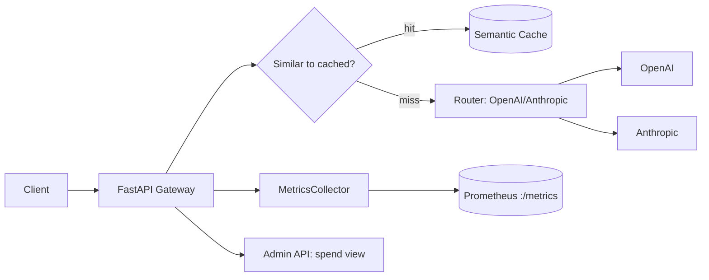

# llm-cost-router

[](https://github.com/yakim-nick/llm-cost-router/actions/workflows/ci.yml)

> **Engineering report** — an LLM API gateway that routes requests across providers,
> caches semantically similar calls, and measures cost/latency. By Nick Yakim.

## 1. Problem & goal
Calling LLMs directly gets expensive and opaque: no central cost view, no
deduplication, no fallback between providers. This gateway adds a routing layer
that cuts waste (semantic cache), exposes metrics (Prometheus), and gives an
admin view of spend.

## 2. Architecture



```
 client
   │
   ▼
┌──────────────────────── FastAPI Gateway ───────────────────────┐
│  proxy.py  ──▶ router.py ──▶ providers/{openai,anthropic}        │
│  cache.py  ──▶ SemanticCache (vector similarity)                │
│  metrics.py─▶ Prometheus counters/histograms                     │
│  auth.py   ──▶ request auth                                      │
│  admin.py  ──▶ spend dashboard API                              │
└─────────────────────────────────────────────────────────────────┘
   │                                  │
   ▼                                  ▼
  config.py (settings)          prometheus/prometheus.yml
```

## 3. Components
- `src/routes/proxy.py` — proxy endpoint, provider selection.
- `src/routes/admin.py` — admin/spend view.
- `src/services/router.py` — provider routing logic.
- `src/services/cache.py` — semantic cache (similar request → cached answer).
- `src/services/metrics.py` — Prometheus collectors.
- `src/services/providers/` — OpenAI & Anthropic provider clients.
- `prometheus/prometheus.yml` — scrape config.

## 4. Run
```bash
pip install -e .
uvicorn src.main:app --port 8000
# metrics: GET /metrics
```

## 5. Cost model
Every request increments `llm_gateway_requests_total{provider,model,status}`
and records latency. The semantic cache prevents re-paying for near-identical
prompts — the single biggest cost lever in practice.

## 6. CI
`.github/workflows/ci.yml` — syntax check + pytest, least-privilege
permissions, pinned action versions, Dependabot enabled.

## Author
Nick Yakim — [github.com/yakim-nick](https://github.com/yakim-nick)
