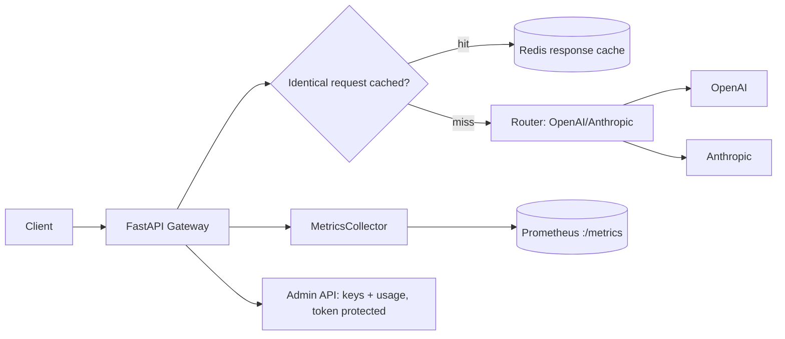

# llm-cost-router

[](https://github.com/yakim-nick/llm-cost-router/actions/workflows/ci.yml)

> **Engineering report** — an LLM API gateway that routes requests across providers,
> caches identical calls, and exposes cost/latency metrics. By Nick Yakim.

## 1. Problem & goal
Calling LLMs directly gets expensive and opaque: no central cost view and
no deduplication. This gateway adds a routing layer that picks a provider/model
by estimated prompt complexity, avoids paying twice for identical requests
(exact-match cache) and exposes cost/latency metrics (Prometheus).

## 2. Architecture



```
 client
   │
   ▼
┌──────────────────────── FastAPI Gateway ───────────────────────┐
│  proxy.py  ──▶ router.py ──▶ providers/{openai,anthropic}        │
│  cache.py  ──▶ ResponseCache (Redis, exact match)               │
│  metrics.py─▶ Prometheus counters/histograms                     │
│  auth.py   ──▶ request auth                                      │
│  admin.py  ──▶ API keys + usage (admin token)                   │
└─────────────────────────────────────────────────────────────────┘
   │                                  │
   ▼                                  ▼
  config.py (settings)          prometheus/prometheus.yml
```

## 3. Components
- `src/routes/proxy.py` — proxy endpoint, provider selection.
- `src/routes/admin.py` — API key management and a usage endpoint, protected by `ADMIN_TOKEN`.
- `src/services/router.py` — provider routing logic.
- `src/services/cache.py` — exact-match response cache in Redis (same messages + model → cached answer). Not semantic.
- `src/services/metrics.py` — Prometheus collectors.
- `src/services/providers/` — OpenAI & Anthropic provider clients.
- `prometheus/prometheus.yml` — scrape config.

## 4. Run
```bash
pip install -e .
uvicorn src.main:app --port 8000
# metrics: GET /metrics
```

### Admin API
`/admin/keys` (create/list API keys) and `/admin/usage` require
`Authorization: Bearer <ADMIN_TOKEN>`. If `ADMIN_TOKEN` is empty the admin API
is disabled (HTTP 503). Generate one with `openssl rand -hex 32`.

## 5. Cost model
Every request increments `llm_gateway_requests_total{provider,model,status}`
and records latency. The response cache prevents re-paying for *identical* requests
(same messages and model, in the same order); a rephrased prompt is a miss.

## 6. Request rules
`POST /v1/chat/completions` (Bearer API key) accepts `model` = `auto` or one of
the models in the price table, 1-100 messages with role `system|user|assistant`
and string content, `temperature` 0-2, and `max_tokens` up to 4096 (default
1024). An explicit model is sent to its own provider; `auto` picks by prompt
complexity. Provider failures return a generic 502 (details only in the logs).

## 7. Known limitations
- The cache is exact-match, not semantic.
- No fallback to another provider when a call fails (the `local` entry in
  `PROVIDER_PREFERENCE_ORDER` has no implementation yet).
- Request usage is exposed through Prometheus; `/admin/usage` reads a
  `usage_logs` table that is not populated yet.
- The token-bucket rate limiter in `src/middleware/rate_limit.py` is not wired in.
- Model names and prices in `proxy.py` / `router.py` are hard-coded and may be
  out of date; check the provider docs before relying on cost numbers.
- Responses are not streamed.

## 8. Roadmap
- Semantic cache (embeddings + similarity threshold).
- Persist per-request usage to `usage_logs`; provider fallback; rate limiting.

## 9. CI
`.github/workflows/ci.yml` — syntax check + pytest, least-privilege
permissions, pinned action versions, Dependabot enabled.

## Author
Nick Yakim — [github.com/yakim-nick](https://github.com/yakim-nick)
